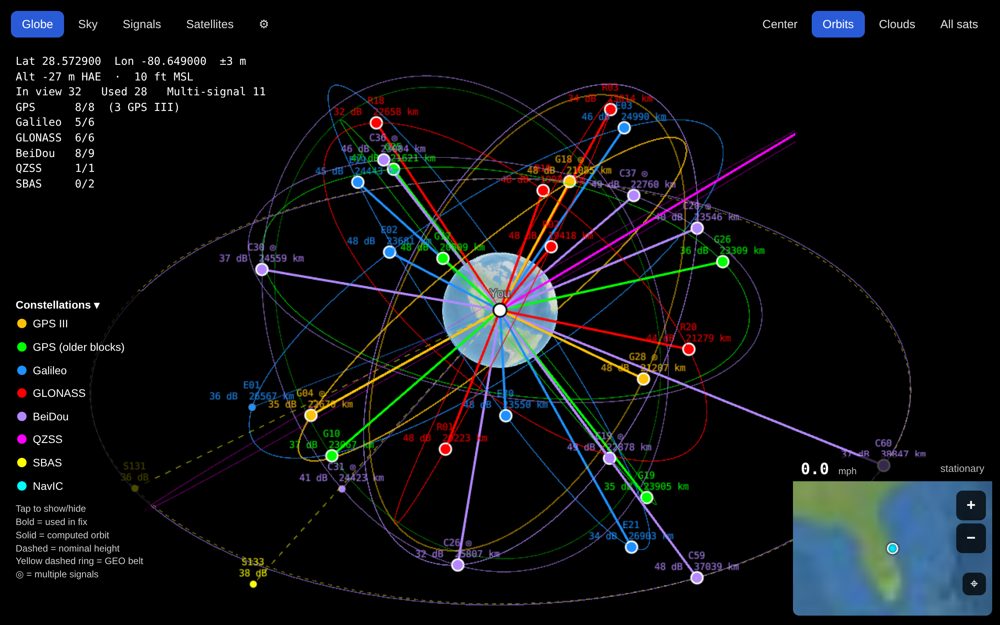
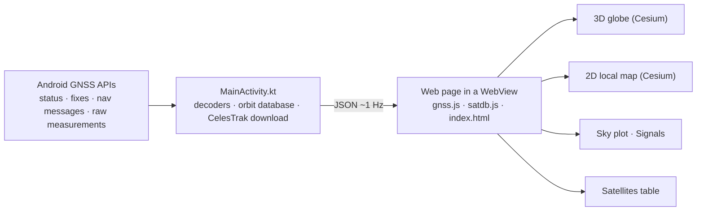

# GNSS Globe

An Android app that turns a tablet's own GNSS receiver into a live 3D view of the satellite constellations: where every satellite in view is, which ones your position fix is using, their orbits, signal strengths and names. Core features work fully offline, and the APK is built entirely from a web browser with GitHub Actions — no desktop or Android Studio needed.

*Demo rendering from simulated satellite data at Kennedy Space Center, at the Galaxy Tab S11's 2560 × 1600 resolution.*

## Features

- **3D globe (Cesium, offline)** — your position and a straight line to every satellite in view, coloured by constellation. Bold = used in the fix; solid line = computed orbit; dashed = direction only. **GPS III satellites are gold.**
- **Orbits for every constellation** — GPS, Galileo, GLONASS, BeiDou (MEO, IGSO and GEO), QZSS and NavIC, each drawn as one full orbit. A dashed ring marks the geostationary belt when SBAS satellites are in view.
- **Sky plot** — azimuth/elevation polar view.
- **Signals** — C/N0 bar for every signal, named from the receiver's raw codes (L1 C/A, L1C, E1, B1I, B1C, G1 …). ◎ marks satellites tracked on more than one signal.
- **Satellites table** — PRN, SVN, long name (e.g. *GPS III SV01 "Vespucci"*), block, orbital slot, launch date, elevation/azimuth, signal, bands and the orbit source in use.
- **Local 2D map** — city-level view with ground speed in mph, heading, breadcrumb trail and zoom buttons.
- **Live clouds** — NOAA GOES-East/West and JMA Himawari infrared (or GOES GeoColor) via NASA GIBS, refreshed every 10 minutes.
- **High-resolution imagery and 3D terrain** — optional, with your own free Cesium ion token.
- **On-device orbit database** — keeps only valid orbit data and deletes it as it expires, so orbits keep working on the road without internet.
- **Self-updating satellite catalog** — names and PRN assignments come from `satdb.json` in this repo; edit it after a launch and the app picks it up, no rebuild.
- Constellation filters, pop-up (floating, resizable) window support, and an info box that fades when idle.

## How it works

Kotlin reads the receiver, decodes broadcast navigation messages, stores orbit data in SQLite and pushes JSON to a single web page bundled inside the APK. The page does the orbit maths and drawing. Cesium and its base imagery ship inside the APK, so nothing core needs a network.

### Where each satellite's orbit comes from

| Priority | Source | Constellations | Accuracy | Kept until |
| --- | --- | --- | --- | --- |
| 1 | Broadcast ephemeris decoded on the tablet | GPS, QZSS, Galileo | ~1 m | toe + 4 h |
| 2 | GPS broadcast almanac decoded on the tablet | GPS | a few km | toa + 14 days |
| 3 | CelesTrak element sets, propagated with SGP4 | all | ~1–few km | epoch + 14 days |
| 4 | Nominal orbit height along the measured direction | anything else (e.g. SBAS) | direction only | — |

CelesTrak names don't carry Android's satellite IDs, so each tracked satellite is paired with the element set whose predicted direction matches the measured azimuth/elevation (within 3°).

The full algorithm write-up — frames and time, LNAV and Galileo I/NAV decoding, orbit propagation, orbit tracks, signal naming and verification — is in the **[wiki](../../wiki)**.

## Install

1. Open **Actions**, pick the latest green run on `main`.
2. Under **Artifacts**, download **gnss-globe-main-apk** and unzip it.
3. Open `app-debug.apk` on the tablet and allow installs from your browser/file manager when asked.
4. Launch **GNSS Globe**, allow precise location, and go outside or near a window.

Requires Android 8.0 (API 26) or newer and a device with a GNSS receiver. Developed on a Samsung Galaxy Tab S11 (single-band L1/E1/B1).

## Build and development workflow

Every push to any branch builds an APK with GitHub Actions (`.github/workflows/build.yml`):

1. Unzip `gnss-globe-project.zip` (a browser can upload files but not folders, so the source travels as one zip).
2. Set up JDK 17 and Gradle 8.11.1.
3. Download the latest Cesium release and bundle it into the app's assets.
4. `gradle :app:assembleDebug`, then upload the APK as an artifact (kept 3 days).

| Branch | Installs as | App ID |
| --- | --- | --- |
| `main` | **GNSS Globe** | `com.moon.gnssglobe` |
| any other (e.g. `dev`) | **GNSS Globe Dev** (purple icon) | `com.moon.gnssglobe.dev` |

Because the IDs differ, both apps can be installed side by side. The usual loop: upload a new zip to `dev`, test **GNSS Globe Dev**, then open a pull request from `dev` into `main`.

To build locally instead: unzip the project, copy Cesium's `Build/Cesium` folder to `app/src/main/assets/cesium`, and open it in Android Studio.

## Settings (⚙)

- **Cesium ion token** — paste your token from ion.cesium.com → Access Tokens for Bing imagery and optional Cesium World Terrain. Stored only on the device.
- **2D map style** — road, aerial, aerial with labels, same as globe, or OpenStreetMap.
- **Live clouds** — infrared or GeoColor, wider coverage, opacity.
- **Orbit data** — counts, CelesTrak status, which navigation messages the receiver provides, and download/clear buttons.
- **Satellite catalog** — which catalog version is in use and a manual update check.

## Repository layout

| Path | What it is |
| --- | --- |
| `gnss-globe-project.zip` | The Android project (unzipped by the build) |
| `satdb.json` | Satellite catalog the app downloads; bump `"version"` when you edit it |
| `.github/workflows/build.yml` | APK build |

Inside the zip:

| Path | What it is |
| --- | --- |
| `app/src/main/java/.../MainActivity.kt` | GNSS callbacks, JSON to the page, settings bridge |
| `app/src/main/java/.../NavDecoders.kt` | GPS/QZSS LNAV and Galileo I/NAV decoders (pure Kotlin) |
| `app/src/main/java/.../OrbitDb.kt` | SQLite orbit database and CelesTrak download |
| `app/src/main/java/.../GpElements.kt` | Two-line element parsing |
| `app/src/main/assets/web/index.html` | Globe, map, sky plot, signals, table, settings |
| `app/src/main/assets/web/gnss.js` | GPS time, orbit propagation, signal naming |
| `app/src/main/assets/web/satdb.js` | Built-in copy of the satellite catalog |
| `app/src/main/assets/web/sgp4/` | satellite.js (SGP4) |

## Data sources and credits

- [CesiumJS](https://cesium.com/platform/cesiumjs/) — 3D globe and 2D map; optional Cesium ion imagery (Bing Maps) and Cesium World Terrain
- [satellite.js](https://github.com/shashwatak/satellite-js) (MIT) — SGP4 propagation
- [CelesTrak](https://celestrak.org/NORAD/elements/) — GNSS orbital element sets
- [NASA GIBS](https://gibs.earthdata.nasa.gov/) — GOES (NOAA) and Himawari (JMA) cloud imagery
- [OpenStreetMap](https://www.openstreetmap.org/copyright) contributors — 2D map tiles
- Satellite catalog compiled from the [USCG NAVCEN GPS constellation status](https://navcen.uscg.gov/gps-constellation) and Wikipedia's GPS, Galileo and BeiDou satellite lists
- [IS-GPS-200](https://www.gps.gov/technical/icwg/) — GPS navigation message and user algorithm

## Known limitations

- BeiDou and GLONASS navigation messages aren't decoded on the device; those satellites use CelesTrak elements.
- Galileo and QZSS decoding depends on the receiver passing those messages to apps.
- GPS–UTC leap seconds are fixed at 18.
- Cesium isn't pinned to a version, so a future major release could break a build.
- Builds are signed with a debug key stored in this public repo — fine for personal sideloading, not for publishing.

No license has been chosen yet.
